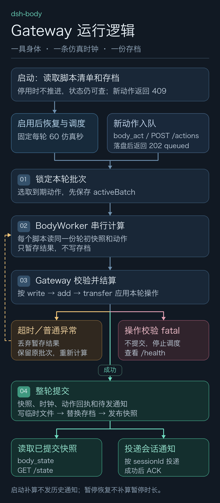

# dsh-body

> 版本：`v0.2.0`（正式版）

`dsh-body` 是 [DSH](https://github.com/deepseek-ai/deepseek-harness) 的虚拟身体插件。核心是一个**按固定步长结算、可从存档恢复的仿真 Gateway**：会话提交动作，器官脚本计算下一状态，Gateway 决定时间何时前进、哪些结果一起生效。身体启用时，即使会话空闲，仿真也会继续。

## 极高的可自定义程度与可扩展性

整个项目围绕“数据驱动配置 + 独立模块化器官”设计，无需改动 Gateway 主干即可按个人需求自由定制各部位内容、数值与交互体验：

- **自由组合与替换器官模块：** 通过脚本清单（默认 [`body-modules.json`](body-modules.json)、[`body-modules.female.json`](body-modules.female.json)、[`body-modules.male.json`](body-modules.male.json) 或自定义 `manifestPath`）自由增删、重排或替换任意部位的 `.ts` 脚本（例如按需切换到独立的中枢/肾性尿崩症变体清单，或只保留关心的一组器官）。新增一个器官只需编写单个模块（导出 `id`、`fields`、`initialState` 与 `heartbeat(io)`）并登记进清单；跨器官参数直读已解耦，替换某一器官实现时不会牵连其他部位。
- **参数外置与单具身体精细定制：** 所有生理数值与策略阈值均外置在同目录 `*.parameters.json` 中，可直接调整默认模型行为；也可不改代码，仅在单具身体的存档 `body-state.json` 顶层通过 `profile`（`weightKg`、`heightCm`、`timezoneOffsetMin`、女性静息泌乳预设 `lactating`）、稀疏字典 `parameters`（按参数 ID 精准覆盖任意默认值）以及 `nsfw` 开关，为不同设定定制专属体质与内容边界。
- **可扩展的体感、通知与动作场景：** 自定义器官或拓展逻辑可向 `interoception.sensations` 写入任意自定义体感（自带强度、阈值与定性描述），自动无缝接入 [`body_state`](tools.js) 的零数字主观感受汇总、[`brainNotify`](organs/human-organs/brain/notify.ts) 的主动提醒与睡眠唤醒链路；具体的饮食、生活剧本或特殊状态也可自由维护在 `scenarios/`、`startupScripts` 初始化脚本与动作载荷中（具体接入规范见 [`docs/gateway-and-scripts.md`](docs/gateway-and-scripts.md)）。

## Gateway 设计

**一具身体、一条仿真时钟、一份存档。** [Gateway](gateway.js) 在 DSH 宿主进程的主线程管理动作队列、调度和提交；[BodyWorker](gateway/body-worker.js) 在独立工作线程运行器官脚本。[`body-modules.json`](body-modules.json) 决定加载哪些脚本；`body-state.json` 由 Gateway 写，保存这一具身体的状态。加一个器官不需要再造一套时钟、动作入口或存档。

### 动作与时钟分开：接收不等于生效

[`body_act`](tools.js) 从 DSH 进程内直接提交动作，本地 `POST /actions` 也进入同一个[动作队列](gateway/actions.js)。Gateway 写入动作并分配预定生效的仿真时刻 `effectiveAt`，再返回 `202 queued`，不在请求里直接改胃容积。动作记录仍保留时，同 ID、同载荷的重试返回当前回执，不重复入队；同 ID 换载荷则返回 `409`。执行中的批次不会被新动作插队。

[调度器](gateway/simulation.js) 用现实时间锚点 `wallTimeMs` 判断哪一轮到期，用 `simulatedSeconds` 记录身体确实走到哪一轮。每轮固定计算 **60 个仿真秒**，成功提交才推进。脚本算得慢或失败，不会因此拿到一个更大的仿真步长。

### 计算与写入分开：一轮只读一份快照

启用时，一个常驻 Worker 按清单顺序运行脚本；所有脚本拿到**同一份不可变的轮初快照和动作批次**。比如一条饮水动作排到第 N 轮，读胃状态的其他脚本要到第 N+1 轮才能看到胃脚本的新写入。代价是跨模块信号有轮次延迟，换来同一轮不会因脚本先后执行而读到别人更新了一半的身体。

部位遵循**单写者**约束：`io.write` 只能暂存本部位的完整下一状态。要跨部位协作，脚本只能向 Gateway 提交操作请求，不能直接改别人的状态。`io.add` 只允许字段所属模块或声明的贡献者为 `additive` 字段记增量；`io.transfer` 只能由源字段所属模块发起，要求两端配对声明、单位相同且源量足够。Gateway 统一按 **write → add → transfer** 结算，脚本不负责持久化。详见 [Gateway 操作层](docs/gateway-operations.md)。

### 提交与恢复：先锁定输入，再一次发布结果

在线开算前，Gateway 先把本轮的动作 ID 和目标时刻写进 `activeBatch`。成功时，快照、时钟、动作回执和待发通知一起提交；[存档层](gateway/checkpoint.js) 写临时文件并替换原存档，然后才更新内存版本。即使 Worker 正在算，`body_state` / `GET /state` 仍读取上一次已提交的快照。`applied` 表示动作所在的轮次已提交；单个动作的回执由 `GET /actions/:id` 查询。

- **超时或普通脚本异常：** 丢弃整轮暂存结果，保留原批次和快照；[运行器](gateway/runner.js) 可重建 Worker，下一次仍从同一批输入重试。
- **操作层校验失败：** 不发布本轮结果，清除在途批次、保留排队动作，并停止调度；通过 `/health` 看 `fatal` 原因，修复后重启。
- **正常停机、主动暂停与未绑定休眠：** 正常重启按 `catchUpMinutes` 限额逐轮补算；存档顶层 `active: false` 是最高优先级的手动硬暂停，只冻住身体时钟，恢复不追算暂停时长；若以 `requireBinding: true` 启动（DSH 插件默认启用），存档未绑定 `boundSessionId` 时身体处于 `dormant` 休眠状态（支持 `body_bind` 或 `POST /bind` / `POST /unbind` 绑定或解绑，休眠期同样冻结时钟且唤醒时不补算休眠时间，绝不覆盖 `active: false`）。此外，存档顶层可选 `nsfw`（默认 `false`）总控性与泌乳生理入口。

[通知泵](notifications.js) 与轮次计算分开：`io.notify` 只暂存通知，在线轮次提交后才按 `sessionId` 投递，成功后 ACK。启动补算不产生补发通知，会话不在线也不会阻塞身体继续推进。这个提交边界保护的是 Gateway 管理的状态和通知队列；Worker 不是安全沙箱，通知投递与存档也不是同一个事务。

## 运行逻辑示意图



## 当前实现范围

根清单 `body-modules.json`（45 部位、40 份唯一参数文件，硬 transfer 闭包 15 部位；`sex` / `orgasm` 动作入口默认受 `nsfw: false` 门控）：

| 器官 | 已实现功能 |
| --- | --- |
| 胃 | 固/液餐排空（受十二指肠营养暴露反馈抑制）、碳水记账、相对饥饿素（受胃扩张、肠内营养与经 `parseIntake` 校验合法的摄入剂量抑制）、胃壁机械感受 |
| 食管 | 按与胃一致的 `durationMin` 轮次分摊持续饮/食流量（含 `intakeQueue` 持久化），记录转运时延与呛咳风险代理（并入 `discomfort` 第七路与 `body_state` `discomfort`/`esophagus` 聚焦，不单独触发主动通知） |
| 十二指肠 | 近期营养暴露代理（与唾液产率联动放大碳水餐暴露增益） |
| 唾液腺 | 进食/饮水后 5 min 刺激窗口内的唾液产率、脱水时产率下降与湿润度/口干读数（水合静息 100 mm / `dryMouthMm = 0`）；有碳水到达十二指肠时按唾液产率放大淀粉酶增益；唾液不进水账 |
| 小肠 | 水与碳水一阶吸收（脱水时微调水吸收，高血糖经梯度负反馈减慢碳水吸收）；离开通量按 95% 吸收 / 5% 残渣分流转入结肠 |
| [气候与衣层输入](organs/body-inputs/README.md) | 分身体持久化显式温湿输入与逐件穿脱（短袖、外套）；干交换与蒸发透过独立。不接天气服务、不自动穿脱。 |
| 皮肤 | 出汗请求与体液支付的实汗（活动、核心温度和阈间死区）；只对实际蒸发量计算散热，不把蒸发重复计入水账 |
| 肺 | 运动相关呼吸失水、Hey Plot（先扩潮气量后提频）自动通气与静息/运动分离热喘息 |
| 胰腺 | 血糖驱动的血浆胰岛素绝对浓度（`insulinPmolL`，Michaelis–Menten 可饱和清除 ODE）与胰高血糖素相对信号 |
| 肝 | 肝糖原储存（上限 100 g）与平滑比例 + 低血糖/胰高血糖素/皮质醇（`cortisolNmolL / 180`）/交感神经驱动的释放（静息基线 0.096 g/min） |
| 骨骼肌 | 活动状态（`exercise`、`exertion` 解耦后的 `sex`、释放高潮/清零 `stop_exercise` 与 `sleep`）、胰岛素与运动收缩摄糖聚合器、头/躯干/四肢三个区域糖原（初值合计 300 g、总消耗 0.5 g/min） |
| 肾 | ADH 驱动产尿（受 GFR 缩放）、肾糖质量排泄；肾糖异生按平滑比例在空腹/低血糖或胰高血糖素高于基线时向葡萄糖隔室产糖（静息基线 0.024 g/min）；可选中枢/肾性 DI 变体（独立清单） |
| 膀胱 | 储尿、主动排尿、过度充盈非自主排空（`involuntaryVoidedMl` 触发一次高危漏尿通知） |
| 结肠 | 残渣水指数回收（`0.01 /min`）回流体液、粪便储存、`defecate` 排出与便意读数 |
| 脑 | 下丘脑 ADH（含血容量驱动）、基于 `Hughes 2018` 高渗拟合与 0 mm 水合基线的口渴驱动、内分泌轴（TRH/CRH 与垂体 `tshRelative`/`acthPgMl`/`prolactinNgMl`/`oxytocinPgMl`）、自主神经、中枢奖赏、体温调节（带符号干交换、受限蒸发、昼夜/睡眠基线与缺省为零的可选发热增量）、睡眠节律、体感读出（23 项 0–100 mm 读数与 Gagge 平衡潮湿感 `sweatDampMm`）、全感受与高潮/受阻无数字通知策略及 `wake-evaluation.ts` 共享睡醒判定 |
| 甲状腺 | TSH 驱动的 T4 相对信号（1440 min 代谢池时间尺度），缩放基础氧耗并负反馈抑制 TRH/TSH |
| 肾上腺 | ACTH Hill 驱动与 49 min 实证消除的总皮质醇浓度（`cortisolNmolL`，基线 `180 nmol/L`），缩放肝糖释放、产生 `stressMm` 并负反馈抑制 CRH/ACTH |
| 甲状旁腺 | 血钙负反馈调控的血浆 PTH 物理浓度代理（`pthPgMl`，`pg/mL`，参考基线 `30`、上限 `90`、`15 min` 半时） |
| 松果体 | 仿真昼夜褪黑素相对信号（含清醒光照抑制与 39.4 min 平滑），协同 `sleep.sleepPressureMm` 驱动 `sleepinessMm` |
| 心脏 | 活动强度、自主神经交感张力、睡眠分期副交感下调、血容量前负荷及共享睡醒/危机判定驱动的心率、搏出量与心输出量代理 |
| 体液隔室 | 体液水与水分亏缺，按肾 → 肺 → 汗结算（女性清单再加子宫 → 乳腺） |
| 葡萄糖隔室 | 可及池质量与浓度代理，含基础非胰岛素耗糖（0.12 g/min），按肾 → 肝 → 肌结算摄糖请求；女性变体末位加乳腺乳糖汇 |
| 血液隔室 | 血容量与体液水联动（`waterVolumeMl / 30000`，钳位 2500–6000 mL），由心输出、自主交感与 SpO2 推出氧输送能力、血压（静息 120/80 mmHg）与肾滤过（GFR）代理 |
| 血氧隔室 | 行为、消化、睡眠与 T4 缩放基础氧耗（T4=1 时 1.0× = 250 mL/min）、受通气与循环上限约束的供需平衡与 SpO2 代理 |
| 血钙隔室 | 血钙浓度（`mgDl`，基线 `9.5`）与骨钙缓冲库（`boneStoreG`，初始 `100 g`、上限 `200 g`），读 `parathyroid.pthPgMl` 维持释放/沉积及 GFR 重吸收稳态；经 `interoception` 接入 `brainNotify` 与 `wake-evaluation` 主动提醒与睡醒判定 |

女性清单 `body-modules.female.json`（48 部位、43 份唯一参数文件，硬 transfer 闭包 17 部位，独立存档）在此基础上增加：

| 器官 | 已实现功能 |
| --- | --- |
| 卵巢 | 基于 `stricker-2006` 的周期日插值物理浓度（`estradiolPmolL`、`progesteroneNmolL`、`lhIuL`、`fshIuL`）与慢性高催乳素/泌乳抑制状态 |
| 子宫 | 内膜增厚、经期失水（`30 mL/周期` 代理）、痛经（并入 `discomfort` 第五路）与高潮/催产素相关 `contractionMm` / `pelvicCongestionMm` |
| 乳腺 | 默认非泌乳（`lactating: false`、0 泌乳、`prolactinNgMl` 维持昼夜基线约 `8 ng/mL`），受 `nsfw` 开关门控；支持 `profile.lactating: true` 或多日诱导状态机（`galactorrhea` 溢乳与 `lactating` 规整产奶）、`1 − DF²` 局部自抑制及催产素门控 `express_milk` / `breastfeed` 喷乳反射（并入 `discomfort` 第六路；合成水走 `bodyFluid` 第五出口，乳糖走女性 `glucose` 变体，绝不双扣体液） |

男性清单 `body-modules.male.json`（47 部位、42 份唯一参数文件，硬 transfer 闭包 15 部位，独立存档）在根清单上只增加：

| 器官 | 已实现功能 |
| --- | --- |
| 睾丸 | 睾酮相对量（基线 1、昼夜波动、60 min 半时、`sleepDebtDays` 多日睡眠债与应激/高 PRL 抑制），放大性反应唤醒并产生 `libidoMm`（受 `nsfw` 门控） |
| 附睾 | 精液储存（上限 5 mL，按速率回补），高潮后排空为 `ejaculatedMl` |

**膳食长链脂质选配清单**：[`organs/presets/human-lipid/body-modules.json`](organs/presets/human-lipid/body-modules.json) 在根清单上只替换共享胃入口并增加七个部位（共 52 部位、47 份唯一参数文件、19 部位 transfer 闭包）。按[中文启用说明](organs/presets/human-lipid/README.md)设置 `manifestPath` 与独立 `statePath`，沿用 `body_act(eat/drink)`；`fatG` 可选，明确为零填 `0`、未知省略，不从热量反推。胆囊回补、胰外分泌和肠淋巴推动已知餐源脂质账，不改变默认、女性或男性清单，也不新增内脏动作。选配清单保留根清单的气候与衣层输入。

仓库共有 55 份 `.parameters.json` 文件（根清单 40 份 + 女性新增 3 份 + 男性新增 2 份 + 3 份未挂入主清单的 DI 变体 + 脂质预设新增 7 份）。`parathyroid` 与 `calcium` 已挂载进默认、女性和男性清单，各器官脚本只读取本目录参数文件（`blood.ts` / `duodenum` 已通过 `heart.maxCardiacOutputMlMin` 与各自参考参数完成跨器官参数文件解耦）。各身体使用独立存档。

Gateway 现同时在 `<bodyDir>/logs/` 维护滚动历史（均设有界保留上限，默认各 `500` 条）：`logs/state-history.jsonl` 仅在状态发生变化或初始/补算提交时追加变更字段，`logs/notification-history.json` 记录每条通知从 `queued` → `acked`（绑定投递 `messageId`）→ `inserted`（由 DSH `agent/inbox/inserted` 事件或 `/notifications/receipt` 确认进入会话收件箱）的状态与时间戳。

完整部位与动作以三份基础清单、选配清单、`tools.js` 与各器官 README 为准。

### Agent 行为

- `body_bind` 显式管理当前会话与身体的绑定/解绑或状态查询（`action: 'bind' | 'unbind' | 'status'`）；DSH 插件默认以 `requireBinding: true` 启动，未绑定时身体保持 `dormant` 休眠（时钟冻结且唤醒不补算休眠时间），`agent/disposed` 时自动解绑；多身体场景由 [multibody.js](multibody.js) 按 `bodies.json` 路由各会话独立身体。
- `body_act` 提交身体动作：支持 `eat`、`drink`、`exercise` 及 `nsfw: true` 时的 `sex`（可选 `exertion` 解耦全身负荷与感官刺激）/ `express_milk` / `breastfeed`，以及无载荷的 `urinate`、`defecate`、`stop_exercise`、`sleep`、`wake_up`（与 `nsfw: true` 时的 `orgasm`，可选 `continueStimulation`）。主对话 Agent 可优先传自然语言 `description`（由 [action-translator.js](action-translator.js) 经 `ctx.llm.stream()` 单工具调用翻为生理数值，并从当前身体 `<bodyDir>/logs/action-translations.json` 同类型最近 100 条里匹配相似与连续参考；`ctx.llm` 不可用/多次失败时直接报错，不胡编数值；`eat`/`drink` 时在顶层顺手返回纯定性零数字味觉文本 `tasteFeedback`），也兼容直传定量字段；动作进入队列下一轮结算，同 ID 同输入重试复用回执。
- 场景与穿着可经 `POST /actions` 或原 `body_act` 明确提交 `set_environment`（完整温湿对）、`wear_layer` / `remove_layer`（`layerId`）。不从描述猜测气候或衣层。见[动作与恢复契约](docs/gateway-and-scripts.md#身体气候与衣层当前模块)。
- `body_state` 把已提交的身体快照转为**纯定性、零数值**的主观感受摘要（不包含任何数字、单位或生理测定值；`nsfw: false` 时屏蔽性/泌乳感受）；原始精确数值仅保留在调试/测试通道 `GET /state` 与 `gateway.getState()`。
- `index.js` 在宿主存在 `systemPrompt` 服务时注册静态纯感觉准则（`systemPrompt.section`）与已绑定激活态的轻度背景体感（`systemPrompt.context`，均零数值）；无该服务时安全旁路；存在 `ctx.on` 时监听 `agent/inbox/inserted` 并回写通知阅读回执到 `logs/notification-history.json`。
- `brainNotify` 覆盖除食管呛咳与 `discomfort` 外的核心、扩展体感（含低钙/高钙）、漏尿边沿、高潮/受阻边沿与非标 `sensations`，采用普通（20–240 min）/高危（5–60 min）双轨指数退避、滞回与缓解重置、睡眠门控、NSFW 门控与多感受零数字聚合。
- LLM 通过提交动作驱动身体，状态由器官脚本计算并整轮提交。
- 参数全库共 55 份 `.parameters.json`、412 条参数：`prior` 19 项（有登记文献支撑）、`fitted_dev` 1 项（开发集拟合，不是独立验证）、`design` 372 项（工程假设，含选配脂链 22 项）、`policy` 20 项（提醒策略），无 `validated`。既有生理校准、解耦与多身体逻辑已有离线、真实 Gateway 集成及容器内 DSH 挂接观察。选配脂链和身体热输入以本版真实 Gateway 回放验账，未做对应的 DSH 宿主会话或独立人体、临床验证。

## 开发与验证

- **一个部位 = 一个后台子代理整包**：模块、参数、单元测试、清单与文档一起完成，spec 写半页即可；相关小部位可打包一片，主代理最后跑 `npm test` 与 `git diff --check`。
- **测试底线**：质量守恒、transfer 双向闭包、旧档与重启、参数 schema（`owner` 前缀、`design` / `source`、`unset` / `null`）、JSON-safe。这些是反复抓到过 bug 的地方。
- **Gateway 的 transfer 顺序**：按 `fromPart.fromField->target` 排序（`gateway/operations.js:206`），与模块调用顺序无关；write 先于 transfer，源余额按 write 值逐笔校验，所以 write 值必须覆盖本轮全部转出。
- **不要写“轨迹逐位一致”**：用加法构造 write 值时跨二进制 binade 会差 1 ulp，应写 ≤ 1 ulp 或给容差。
- **质量账只记真实转移量**：请求字段不入账，在途字段（本轮到账、下轮入账）必须入账，否则账会漏。

## 快速开始

需要 **Node.js ≥ 22.18** 运行本仓库（注：若挂载到上游 DSH 宿主 `dsh-v0.2.3-alpha.2` 运行，宿主本身要求 `Node ^24.22.3 || >=26.13.1`）。在源码目录下即可运行测试和离线重放，不需要安装第三方依赖或启动 DSH（注意 Node 类型擦除只支持本地源码路径下的 `.ts`，若安装进 `node_modules` 需先预编译为 `.js`）：

```sh
git clone https://github.com/P-A-N-52/dsh-body.git
cd dsh-body
npm test
node tools/replay.mjs scenarios/p1-cola-330.json
node tools/replay.mjs --manifest body-modules.json scenarios/m1-water-240.json
```

示例支持默认 5 模块 P0/P1 子集重放（如 `p1-cola-330.json`），也支持通过 `--manifest` 按完整清单（`body-modules.json` / `.female.json` / `.male.json`）运行含 `transfer` 守恒的全部位离线重放。它们都不会写身体存档，也不验证真实会话里的通知投递。

### 接入 DSH

已安装 DSH CLI 时，在 `dsh-body` 源码目录下运行：

```sh
dsh plugin --profile web add "$(pwd)"
dsh web
```

保持 DSH 运行，在另一终端用 `curl -fsS http://127.0.0.1:3210/health` 查看启停状态和轮次错误。Gateway 默认仅监听本机 `127.0.0.1:3210`，接口没有令牌鉴权，不要将该端口转发到公网。DSH 默认将存档写入 `$DSH_HOME/dsh-body/body-state.json`（通常是 `~/.dsh/dsh-body/body-state.json`）；自定义路径、暂停恢复和 HTTP 接口见 [Gateway 开发指南](docs/gateway-and-scripts.md)。

## 代码与文档入口

| 入口 | 内容 |
| --- | --- |
| [`index.js`](index.js)、[`gateway/`](gateway/) | DSH 插件入口；本地 HTTP、动作队列、轮次结算和存档。 |
| [`body-modules.json`](body-modules.json)、[`body-modules.female.json`](body-modules.female.json)、[`body-modules.male.json`](body-modules.male.json)、[`organs/human-organs/`](organs/human-organs/) | 脚本清单；[胃](organs/human-organs/stomach/README.md)、[食管](organs/human-organs/esophagus/README.md)、[唾液腺](organs/human-organs/salivary-glands/README.md)、[十二指肠](organs/human-organs/duodenum/README.md)、[小肠](organs/human-organs/small-intestine/README.md)、[结肠](organs/human-organs/colon/README.md)、[骨骼肌活动与肌糖原](organs/human-organs/skeletal-muscle/README.md)、[分区骨骼肌](organs/human-organs/skeletal-muscle/regions/README.md)、[性反应](organs/human-organs/sexual-response/README.md)、[睾丸](organs/human-organs/testes/README.md)、[附睾](organs/human-organs/epididymis/README.md)、[皮肤](organs/human-organs/skin/README.md)、[肺](organs/human-organs/lungs/README.md)、[胰腺](organs/human-organs/pancreas/README.md)、[肝](organs/human-organs/liver/README.md)、[肾](organs/human-organs/kidney/README.md)、[膀胱](organs/human-organs/bladder/README.md)、[卵巢](organs/human-organs/ovaries/README.md)、[子宫](organs/human-organs/uterus/README.md)、[乳腺](organs/human-organs/mammary-glands/README.md)、[甲状腺](organs/human-organs/thyroid/README.md)、[甲状旁腺](organs/human-organs/parathyroid/README.md)、[肾上腺](organs/human-organs/adrenal/README.md)、[松果体](organs/human-organs/pineal/README.md)、[心脏](organs/human-organs/heart/README.md)、[体感和提醒](organs/human-organs/brain/README.md)的模块、参数与证据；[体液隔室](organs/human-compartments/body-water/README.md)、[葡萄糖隔室](organs/human-compartments/glucose/README.md)、[血液隔室](organs/human-compartments/blood/README.md)、[血氧隔室](organs/human-compartments/blood-oxygen/README.md)与[血钙隔室](organs/human-compartments/calcium/README.md)是隔室而不是器官。女性与男性清单各用独立存档。 |
| [`docs/gateway-and-scripts.md`](docs/gateway-and-scripts.md)、[`docs/gateway-operations.md`](docs/gateway-operations.md) | 当前接口、脚本接入，以及 `write` / `add` / `transfer` 的边界。 |
| [`docs/superpowers/specs/`](docs/superpowers/specs/) | 设计文档，批准状态以各文档的状态行为准：器官模型、固／液餐、水链、碳水—血糖、胰腺相对胰岛素、肾糖、口渴提醒、活动—皮肤出汗、运动相关呼吸失水、过度充盈与不适、女性生殖周期、肝糖原与胰高血糖素、血氧池与肺通气、内分泌轴与松果体、可选 DI 样代理，以及后续的分区骨骼肌、性反应、自主摄糖、食管与结肠、循环、体温调节、肾糖异生、唾液腺、乳腺、男性生殖、甲状旁腺与血钙、消化反馈、大脑感知与睡眠闭环。 |
| [`docs/virtual-body.md`](docs/virtual-body.md) | 设计草案与路线图，设计目标不等于已实现功能。 |
| [`CONTRIBUTING.md`](CONTRIBUTING.md) | 开发与协作约定：脚本、参数、证据与提交。 |

## 本人后记

坏了，好像做成人体的数学建模了...
各位大佬别挑刺啊，本人生物水平仅限于高中级别，很多理论建模和后续完善依赖于AI，并且因为复杂度已经做出来很多取舍和改变了，有问题也欢迎指出来。

## 许可证

本项目的原创代码和文档采用 [MIT License](LICENSE)。第三方内容仍遵循各自的许可。
