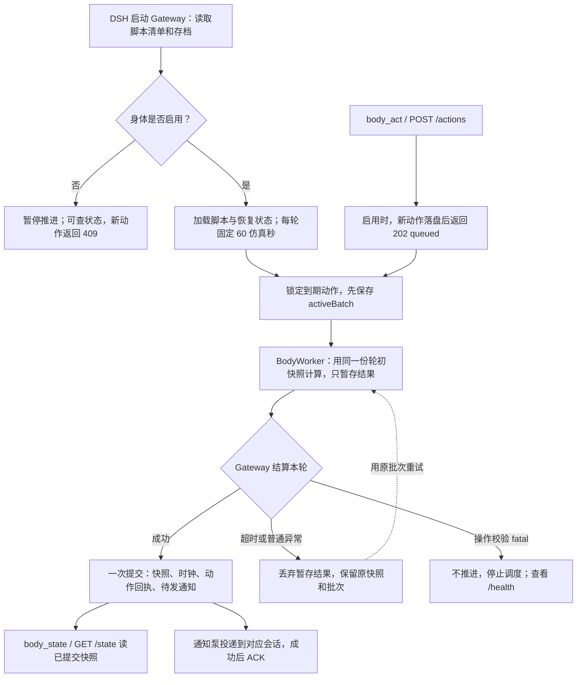

# dsh-body

`dsh-body` 是 [DSH](https://github.com/deepseek-harness/deepseek-harness) 的虚拟身体插件。核心是一个**按固定步长结算、可从存档恢复的仿真 Gateway**：会话提交动作，器官脚本计算下一状态，Gateway 决定时间何时前进、哪些结果一起生效。身体启用时，即使会话空闲，仿真也会继续。

## Gateway 设计

**一具身体、一条仿真时钟、一份存档。** [Gateway](gateway.js) 在 DSH 宿主进程的主线程管理动作队列、调度和提交；[BodyWorker](gateway/body-worker.js) 在独立工作线程运行器官脚本。[`body-modules.json`](body-modules.json) 决定加载哪些脚本；`body-state.json` 由 Gateway 写，保存这一具身体的状态。加一个器官不需要再造一套时钟、动作入口或存档。

### 动作与时钟分开：接收不等于生效

[`body_act`](tools.js) 从 DSH 进程内直接提交动作，本地 `POST /actions` 也进入同一个[动作队列](gateway/actions.js)。Gateway 写入动作并分配预定生效的仿真时刻 `effectiveAt`，再返回 `202 queued`，不在请求里直接改胃容积。动作记录仍保留时，同 ID、同载荷的重试返回当前回执，不重复入队；同 ID 换载荷则返回 `409`。执行中的批次不会被新动作插队。

[调度器](gateway/simulation.js) 用现实时间锚点 `wallTimeMs` 判断哪一轮到期，用 `simulatedSeconds` 记录身体确实走到哪一轮。每轮固定计算 **60 个仿真秒**，成功提交才推进。脚本算得慢或失败，不会因此拿到一个更大的仿真步长。

### 计算与写入分开：一轮只读一份快照

启用时，一个常驻 Worker 按清单顺序运行脚本；所有脚本拿到**同一份不可变的轮初快照和动作批次**。比如一条饮水动作排到第 N 轮，读胃状态的其他脚本要到第 N+1 轮才能看到胃脚本的新写入。代价是跨模块信号有轮次延迟，换来同一轮不会因脚本先后执行而读到别人更新了一半的身体。

部位遵循**单写者**约束：`io.write` 只能暂存本部位的完整下一状态。要跨部位协作，脚本只能向 Gateway 提交操作请求，不能直接改别人的状态。`io.add` 只允许字段所属模块或声明的贡献者为 `additive` 字段记增量；`io.transfer` 只能由源字段所属模块发起，要求两端配对声明、单位相同且源量足够。Gateway 统一按 **write → add → transfer** 结算，脚本不负责持久化。详见 [Gateway 操作层](docs/gateway-operations.md)。

### 提交与恢复：先锁定输入，再一次发布结果

在线开算前，Gateway 先把本轮的动作 ID 和目标时刻写进 `activeBatch`。成功时，快照、时钟、动作回执和待发通知一起提交；[存档层](gateway/checkpoint.js) 写临时文件并替换原存档，然后才更新内存版本。即使 Worker 正在算，`body_state` / `GET /state` 仍读取上一次已提交的快照。`applied` 表示动作所在的轮次已提交；单个动作的回执由 `GET /actions/:id` 查询。

- **超时或普通脚本异常：** 丢弃整轮暂存结果，保留原批次和快照；[运行器](gateway/runner.js) 可重建 Worker，下一次仍从同一批输入重试。
- **操作层校验失败：** 不发布本轮结果，清除在途批次、保留排队动作，并停止调度；通过 `/health` 看 `fatal` 原因，修复后重启。
- **正常停机与主动暂停不同：** 正常重启按 `catchUpMinutes` 限额逐轮补算；显式暂停只冻住身体时钟，恢复不追算暂停时长。没有完成的批次保存在存档里，不需要会话再发一次。

[通知泵](notifications.js) 与轮次计算分开：`io.notify` 只暂存通知，在线轮次提交后才按 `sessionId` 投递，成功后 ACK。启动补算不产生补发通知，会话不在线也不会阻塞身体继续推进。这个提交边界保护的是 Gateway 管理的状态和通知队列；Worker 不是安全沙箱，通知投递与存档也不是同一个事务。

## 运行逻辑示意图



## 当前实现范围

当前已接入胃动力、相对饥饿素、胃壁机械感受代理、十二指肠营养暴露代理，以及饥饿／饱满读出和提醒策略。`body_act` 接收结构化 `drink` / `eat`，不负责从菜名推算容量或热量；饥饿／饱满值是模型代理量，不是人体实测。现在不是全身生理模拟器，也不支持按会话选择不同身体。`systems/` 中的系统目录是历史资料，不代表已有对应模拟。

## 快速开始

需要 **Node.js ≥ 22.18**。在源码目录下即可运行测试和离线重放，不需要安装第三方依赖或启动 DSH：

```sh
git clone https://github.com/P-A-N-52/dsh-body.git
cd dsh-body
npm test
node tools/replay.mjs scenarios/p1-cola-330.json
```

示例重放 330 mL、140 kcal 的含糖饮料，输出胃内体积、能量及饥饿／饱满等观测点的 JSON。它不会写身体存档，也不验证真实会话里的通知投递。

### 接入 DSH

已安装 DSH CLI 时，在 `dsh-body` 源码目录下运行：

```sh
dsh plugin --profile web add "$(pwd)"
dsh web
```

保持 DSH 运行，在另一终端用 `curl -fsS http://127.0.0.1:3210/health` 查看启停状态和轮次错误。Gateway 默认仅监听本机 `127.0.0.1:3210`，接口没有令牌鉴权，不要将该端口转发到公网。DSH 默认将存档写入 `$DSH_HOME/dsh-body/body-state.json`（通常是 `~/.dsh/dsh-body/body-state.json`）；自定义路径、暂停恢复和 HTTP 接口见 [Gateway 开发指南](docs/gateway-and-scripts.md)。

## 代码与文档入口

| 入口 | 内容 |
| --- | --- |
| [`index.js`](index.js)、[`gateway/`](gateway/) | DSH 插件入口；本地 HTTP、动作队列、轮次结算和存档。 |
| [`body-modules.json`](body-modules.json)、[`organs/human-organs/`](organs/human-organs/) | 脚本清单；[胃](organs/human-organs/stomach/README.md)、[十二指肠](organs/human-organs/duodenum/README.md)、[体感和提醒](organs/human-organs/brain/README.md)的模块、参数与证据。 |
| [`docs/gateway-and-scripts.md`](docs/gateway-and-scripts.md)、[`docs/gateway-operations.md`](docs/gateway-operations.md) | 当前接口、脚本接入，以及 `write` / `add` / `transfer` 的边界。 |
| [`docs/virtual-body.md`](docs/virtual-body.md) | 设计草案与路线图，设计目标不等于已实现功能。 |
| [`CONTRIBUTING.md`](CONTRIBUTING.md) | 开发与协作约定：脚本、参数、证据与提交。 |
