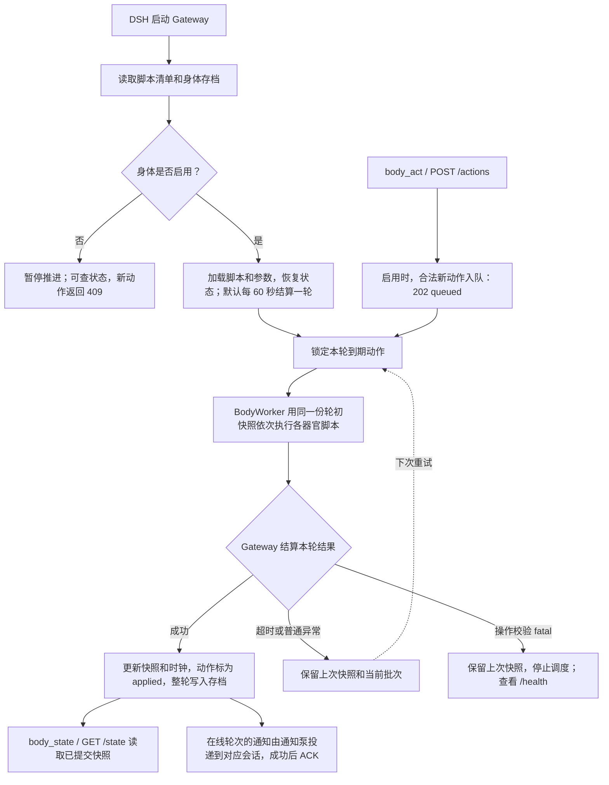

# dsh-body

`dsh-body` 是 [DSH](https://github.com/deepseek-harness/deepseek-harness) 的虚拟身体插件。它接收会话里的饮食动作，由身体 Gateway 每 60 秒结算一轮，再把已提交的身体状态和体感提醒交给会话。

当前实现覆盖胃动力、相对饥饿素、胃壁机械感受代理、十二指肠营养暴露代理，以及饥饿／饱满读出和提醒策略。`body_act` 接收结构化 `drink` / `eat`，不负责从菜名推算容量或热量；`body_state` 读取最新已提交的快照。饥饿／饱满值是模型代理量，不是人体实测。现在是一具身体对应一份存档，不是全身生理模拟器，也不支持按会话选择不同身体。`systems/` 中的系统目录是历史资料，不代表已有对应模拟。

## 运行逻辑示意图



`202 queued` 只表示接受入队，不表示状态已变化；要查单个动作的结算回执，用 `GET /actions/:id`。脚本只能读到本轮开始时的状态；上游脚本本轮写出的新值，要等下一轮才能被下游读到。普通停机重启时按清单上限补算，补算不发通知；从显式暂停恢复时，不补算暂停时长。

## 快速开始

需要 **Node.js ≥ 22.18**。在源码目录下即可运行测试和离线重放，不需要安装第三方依赖或启动 DSH：

```sh
git clone https://github.com/P-A-N-52/dsh-body.git
cd dsh-body
npm test
node tools/replay.mjs scenarios/p1-cola-330.json
```

示例重放 330 mL、140 kcal 的含糖饮料，输出胃内体积、能量及饥饿／饱满等观测点的 JSON。它不会写身体存档，也不验证真实会话里的通知投递。

### 接入 DSH

已安装 DSH CLI 时，在 `dsh-body` 源码目录下运行：

```sh
dsh plugin --profile web add "$(pwd)"
dsh web
```

保持 DSH 运行，在另一终端用 `curl -fsS http://127.0.0.1:3210/health` 查看启停状态和轮次错误。Gateway 默认仅监听本机 `127.0.0.1:3210`，接口没有令牌鉴权，不要将该端口转发到公网。DSH 默认将存档写入 `$DSH_HOME/dsh-body/body-state.json`（通常是 `~/.dsh/dsh-body/body-state.json`）；自定义路径、暂停恢复和 HTTP 接口见 [Gateway 开发指南](docs/gateway-and-scripts.md)。

## 代码与文档入口

| 入口 | 内容 |
| --- | --- |
| [`index.js`](index.js)、[`gateway/`](gateway/) | DSH 插件入口；本地 HTTP、动作队列、轮次结算和存档。 |
| [`body-modules.json`](body-modules.json)、[`organs/human-organs/`](organs/human-organs/) | 脚本清单；[胃](organs/human-organs/stomach/README.md)、[十二指肠](organs/human-organs/duodenum/README.md)、[体感和提醒](organs/human-organs/brain/README.md)的模块、参数与证据。 |
| [`docs/gateway-and-scripts.md`](docs/gateway-and-scripts.md)、[`docs/gateway-operations.md`](docs/gateway-operations.md) | 当前接口、脚本接入，以及 `write` / `add` / `transfer` 的边界。 |
| [`docs/virtual-body.md`](docs/virtual-body.md) | 设计草案与路线图，设计目标不等于已实现功能。 |
| [`CONTRIBUTING.md`](CONTRIBUTING.md) | 开发与协作约定：脚本、参数、证据与提交。 |
